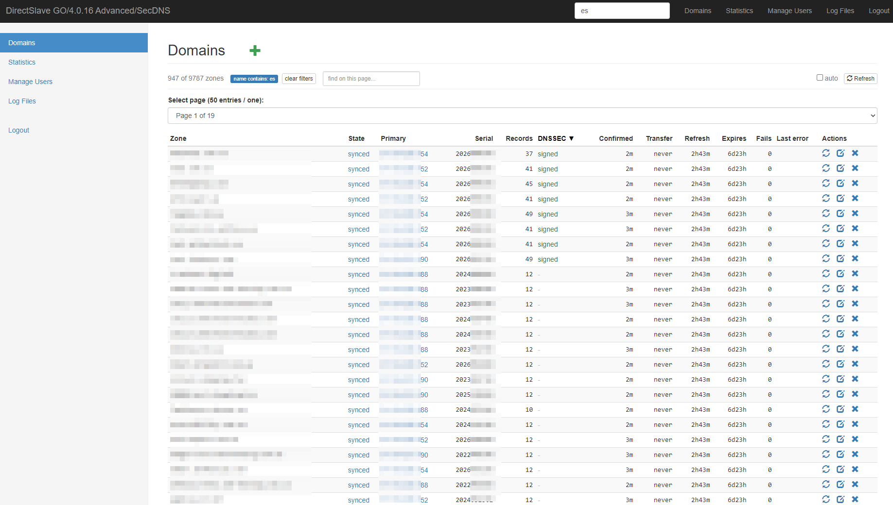

# DirectSlave 4

DirectSlave is a secondary DNS server for [DirectAdmin](https://www.directadmin.com/).
It speaks the DirectAdmin Multi-Server API, so a DirectAdmin server adds,
updates and removes zones on it the same way it would on a second DirectAdmin
box, without a second DirectAdmin license.

Version 4 contains its own authoritative DNS server. One process receives the
API calls, transfers the zones from the primary and answers DNS queries. The
older mode, where DirectSlave only maintains a zone list for BIND and calls
`rndc`, is still available and is what an unchanged 3.x configuration keeps
using.

## Download

Release archives for FreeBSD and Linux (amd64) are on the
[Releases page](https://github.com/directslave/directslave/releases). Each one
extracts into `/usr/local/directslave` and carries its own `INSTALL` file.

## Contents

| Document | What it covers |
|---|---|
| [Installation](docs/installation.md) | Requirements, FreeBSD and Linux install, directory layout, first start |
| [Configuration](docs/configuration.md) | Every option of `directslave.conf`, with defaults |
| [DirectAdmin setup](docs/directadmin.md) | Connecting a DirectAdmin server, how zones are added and who owns them |
| [Command line](docs/command-line.md) | Users and passwords, zone management, status, exit codes |
| [Dashboard](docs/dashboard.md) | The web interface: zones, statistics, users, logs |
| [DNS server](docs/dns-server.md) | How the integrated server transfers and answers, DNSSEC, timers, zone states |
| [Operations](docs/operations.md) | Service control, logs and rotation, HTTPS, backups, hooks, security |
| [Upgrading](docs/upgrading.md) | From 3.x, and from BIND to the integrated server |
| [Troubleshooting](docs/troubleshooting.md) | Start failures, zones that do not transfer, login problems |

Other files in [docs/](docs/):

- `INSTALL-FREEBSD-4.txt`, `INSTALL-LINUX-4.txt`: the short install notes that
  ship inside the release archives.
- `INTEGRATION_NOTES.md`: design notes on how the DNS server was merged in.
- `legacy/`: README and change history of 3.5 and earlier.

## The short version

1. Extract the archive into `/usr/local`, create `directslave.conf` from the
   sample, run `directslave-prepare`.
2. Create an API user: `/usr/local/directslave/bin/directslave --password admin`
3. Check and start: `directslave --check`, then start the service.
4. In DirectAdmin, add the secondary under Multi Server Setup with that user.
5. Make sure the primary allows zone transfers to the secondary and notifies it.

Each step is described in [Installation](docs/installation.md) and
[DirectAdmin setup](docs/directadmin.md).

## Two modes

| | Integrated (`dns_server integrated`) | External (`dns_server external`, default) |
|---|---|---|
| Who answers DNS | DirectSlave | BIND (`named`) |
| Who transfers zones | DirectSlave (AXFR) | BIND |
| `rndc` | not used | called after zone list changes |
| Zone list (`named_conf`) | DirectSlave's own registry | included from BIND's `named.conf` |
| Statistics page, `--dump-db`, zone states | yes | no, the zones are BIND's |

A configuration file without `dns_server` runs in external mode.

## Support

Questions and bug reports: [GitHub issues](https://github.com/directslave/directslave/issues),
or the [DirectSlave thread](https://forum.directadmin.com/threads/directslave-solution-to-add-and-remove-zones-on-slave-without-directadmin.43924/)
on the DirectAdmin forum.

## License

BSD 3-Clause, see [LICENSE](LICENSE). The dashboard bundles Bootstrap 3,
jQuery and Holder.js, each under the MIT license.
